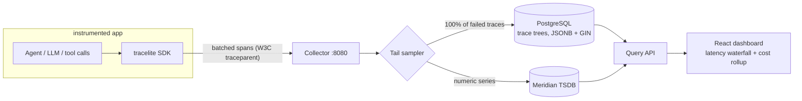

# Tracelite

**OpenTelemetry-style tracing and cost observability for LLM applications.**

LLM applications fail in ways application logs can't answer: which step of an agent run burned
12,000 tokens, which tool call added 4 seconds of latency, which trace cost $0.42 and why it
spiked at 2am. Tracelite instruments LLM, tool, and agent steps as spans, keeps every failed
trace, and rolls numeric series (token throughput, cost, latency) into
[Meridian](https://github.com/th3m45t3rm1nd/meridian), a purpose-built time-series engine.

> **Status:** scaffold — architecture and build plan below; roadmap checkboxes are tracked live
> in this README as the implementation progresses.

## Architecture



## What a span captures

| Field | Meaning |
|---|---|
| `trace_id` / `span_id` / `parent_id` | W3C-compatible identity; `parent_id` builds the causal tree |
| `kind` | `llm` \| `tool` \| `agent` \| `custom` |
| `model` | e.g. `gpt-4o-mini`, `llama3:8b` (local) |
| `start/end` | nanosecond timestamps — the raw material for waterfalls |
| `tokens_in` / `tokens_out` / `cost_usd` | usage + computed spend |
| `attrs` | free-form attributes (prompt id, tenant, endpoint) |

## Design decisions

- **Tail-based sampling:** evaluation happens when a trace *completes*, so the decision to keep
  it can use the outcome. Policy: retain **100% of failed traces**, drop a configured fraction
  (default 90%) of successful ones. Debuggability is preserved where it matters; storage cost
  scales with the failure rate, not the traffic.
- **Two storage engines, two shapes of data:** trace trees are sparse, hierarchical, and
  attribute-searched — a natural fit for PostgreSQL `jsonb` + GIN indexes. Numeric series
  (spans/s, tokens/s, cost/min, latency percentiles) are high-frequency append-only streams —
  the exact workload Meridian's Gorilla compression is built for.
- **W3C trace context:** the SDK propagates `traceparent` headers so spans from different
  services join into one tree.

## Roadmap

**Week 1 — core path**

- [x] Go SDK: span model, batching client, W3C traceparent propagation
- [x] Collector: HTTP ingest (`POST /v1/traces`), in-memory buffering
- [ ] PostgreSQL sink: trace-tree persistence (`jsonb` + GIN)
- [ ] Trace completion detection + tail-sampling gate

**Week 2 — observability + proof**

- [ ] Meridian bridge: numeric series → Meridian HTTP API
- [ ] Query API: waterfall reconstruction, cost rollups, trace attribute search
- [ ] React dashboard (waterfall + spend view)
- [ ] Benchmarks: ingestion spans/s + p99 under load; documented here

## Benchmarks

Filled with measured numbers as the build progresses (see `docs/` in future commits).

| Metric | Result |
|---|---|
| Ingestion throughput | TBD |
| Ingest p99 latency | TBD |
| Trace volume cut (tail sampling @ 90% drop) | ~10× by construction |

## Quickstart

```bash
docker compose up -d          # PostgreSQL for trace trees
go run ./cmd/collector        # collector on :8080
go test ./...                 # unit tests
```

## License

[MIT](LICENSE)
